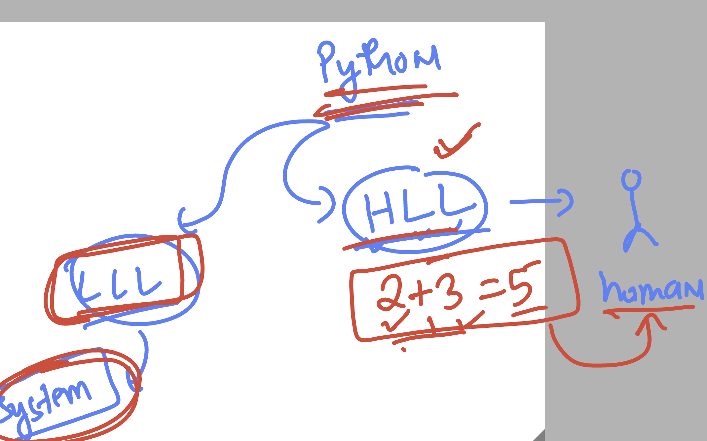
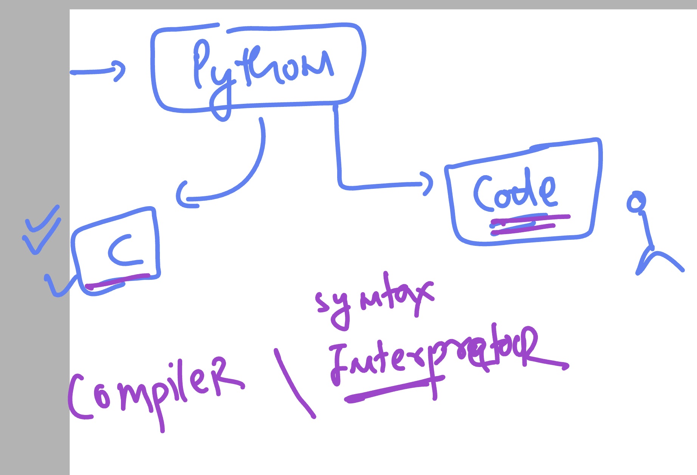
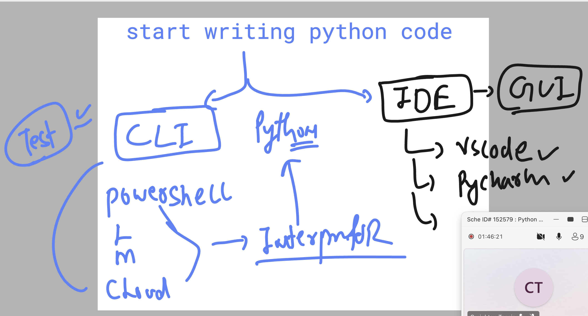
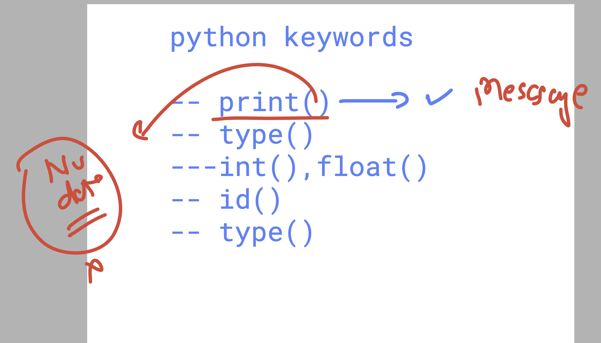
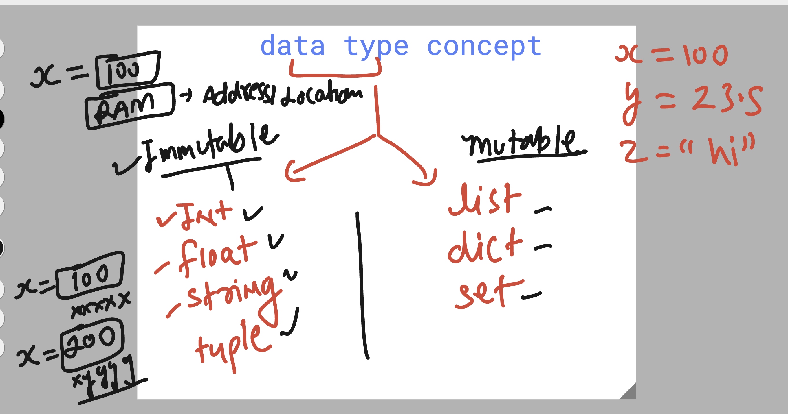
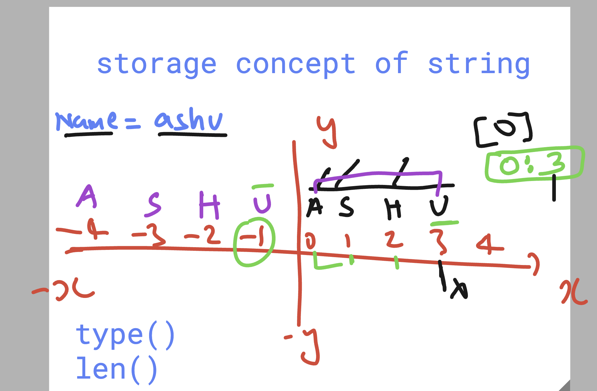

# python_azdevops_cas_20thoct2026

### python understanding 




### python is a Interpretor type lang 



### more info about python 


### checking python version on any shell / cloud / powershell / mac / linux 

```

ashutoshh [ ~ ]$ python -V
Python 3.12.15

ashutoshh [ ~ ]$ python --version 
Python 3.12.15
ashutoshh [ ~ ]$ 

```


### where to write python code 



### using python shell to run basic code

```
ashutoshh [ ~ ]$ python
Python 3.12.15 (main, Oct  5 2026, 16:26:01) [GCC 13.2.0] on linux
Type "help", "copyright", "credits" or "license" for more information.
>>> 3+6
9
>>> 88*3
264
>>> print(" Hello world , welcome to python")
 Hello world , welcome to python
>>> 
>>> exit()
ashutoshh [ ~ ]$ 

```

## python keywords



### using type to understand ops support in data

```
ython
Python 3.12.15 (main, Oct  5 2026, 16:26:01) [GCC 13.2.0] on linux
Type "help", "copyright", "credits" or "license" for more information.
>>> 
>>> 
>>> 4
4
>>> 4+5
9
>>> type(4)
<class 'int'>
>>> 
>>> type("hello")
<class 'str'>
>>> 
>>> 5 + "hello"
Traceback (most recent call last):
  File "<stdin>", line 1, in <module>
TypeError: unsupported operand type(s) for +: 'int' and 'str'
>>> 
>>> 

```

### running python code from vscode 

```
ashutoshh [ ~ ]$ /usr/bin/python /home/ashutoshh/ashu-code/hello.py
Hello world , welcome to python !
1000
55.6
11


ashutoshh [ ~ ]$ python  ashu-code/hello.py 
Hello world , welcome to python !
1000
55.6
11
ashutoshh [ ~ ]$ 


```

### data types in python 



### string storage 




## Info about tuple as storage

```
t1=(55,99,"hello",90.5)
>>> 
>>> type(t1)
<class 'tuple'>
>>> 
>>> len(t1)
4
>>> t1[0]
55
>>> t1[1:]
(99, 'hello', 90.5)
>>> t1[2]
'hello'
>>> t1[2][-1]
'o'
>>> t2=(56,99,'okk')
>>> t3=t1+t2
>>> t3
(55, 99, 'hello', 90.5, 56, 99, 'okk')

```

### dealing with list 

```
>>> l1=["ashu","brand","chris","jas"]
>>> 
>>> len(l1)
4
>>> l1[0]
'ashu'
>>> l1.append(1000)
>>> l1
['ashu', 'brand', 'chris', 'jas', 1000]
>>> l1.insert(0,"python")
>>> l1
['python', 'ashu', 'brand', 'chris', 'jas', 1000]
>>> l1.pop(0)
'python'
>>> l1
['ashu', 'brand', 'chris', 'jas', 1000]
>>> l1.remove('ashu')
>>> l1
['brand', 'chris', 'jas', 1000]

```

# dictionary

```

>>> email_creds = {'ashu@delvex.io':"Hello123",'1211@gmai.com':9090}
>>> len(email_creds)
2
>>> email_creds.keys()
dict_keys(['ashu@delvex.io', '1211@gmai.com'])
>>> email_creds.values()
dict_values(['Hello123', 9090])
>>> email_creds['ashu@delvex.io']
'Hello123'


>>> email_creds['jack@delvex.io']=9090900
>>> email_creds
{'ashu@delvex.io': 'Hello123', '1211@gmai.com': 9090, 'jack@delvex.io': 9090900}
>>> 

```