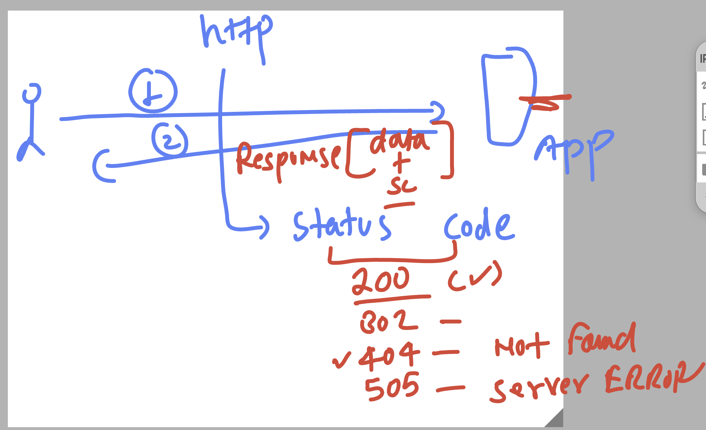

# python_azdevops_cas_20thoct2026

```
>>> import  time 
>>> dir(time)
['CLOCK_MONOTONIC', 'CLOCK_MONOTONIC_RAW', 'CLOCK_MONOTONIC_RAW_APPROX', 'CLOCK_PROCESS_CPUTIME_ID', 'CLOCK_REALTIME', 'CLOCK_THREAD_CPUTIME_ID', 'CLOCK_UPTIME_RAW', 'CLOCK_UPTIME_RAW_APPROX', '_STRUCT_TM_ITEMS', '__doc__', '__loader__', '__name__', '__package__', '__spec__', 'altzone', 'asctime', 'clock_getres', 'clock_gettime', 'clock_gettime_ns', 'clock_settime', 'clock_settime_ns', 'ctime', 'daylight', 'get_clock_info', 'gmtime', 'localtime', 'mktime', 'monotonic', 'monotonic_ns', 'perf_counter', 'perf_counter_ns', 'process_time', 'process_time_ns', 'sleep', 'strftime', 'strptime', 'struct_time', 'thread_time', 'thread_time_ns', 'time', 'time_ns', 'timezone', 'tzname', 'tzset']
>>> del time 
>>> 
>>> from time import  ctime 
>>> from time import  ctime,sleep
>>> 
>>> ctime()
'Wed Oct 21 22:29:17 2026'
>>> sleep(3)
>>> 
>>> import time as  t
>>> t.ctime()
'Wed Oct 21 22:29:48 2026'
>>> t.sleep(1)

```

## Understanding data fetching fundamentals 


### sample json data 

```
{
  "id": 1,
  "name": "John Doe",
  "email": "john.doe@example.com",
  "isActive": true,
  "roles": ["admin", "user"],
  "profile": {
    "age": 30,
    "city": "New York"
  }
}

```

### http status code 



### creating virtual env & install python lib using pip / pip3 

```
root@docker-ubuntu:~/ashu-codes# python3 -m  venv  casinoar-ashu
root@docker-ubuntu:~/ashu-codes# ls
add_function.py  casinoar-ashu  day1_summary.py  final_demo.py  player-age-selector.py  player_check.py  var-test.py
root@docker-ubuntu:~/ashu-codes# 
root@docker-ubuntu:~/ashu-codes# 
root@docker-ubuntu:~/ashu-codes# 
root@docker-ubuntu:~/ashu-codes# source   casinoar-ashu/bin/activate
(casinoar-ashu) root@docker-ubuntu:~/ashu-codes# 
(casinoar-ashu) root@docker-ubuntu:~/ashu-codes# pip3 install requests 
Collecting requests
  Downloading requests-2.34.2-py3-none-any.whl.metadata (4.8 kB)
Collecting charset_normalizer<4,>=2 (from requests)
  Downloading charset_normalizer-3.5.2-cp312-cp312-manylinux2014_x86_64.manylinux_2_17_x86_64.manylinux_2_28_x86_64.whl.metadata (46 kB)
     ━━━━━━━━━━━━━━━━━━━━━━━━━━━━━━━━━━━━━━━━ 46.4/46.4 kB 2.7 MB/s eta 0:00:00
Collecting idna<4,>=2.5 (from requests)
  Downloading idna-3.20-py3-none-any.whl.metadata (7.2 kB)

  ```
  