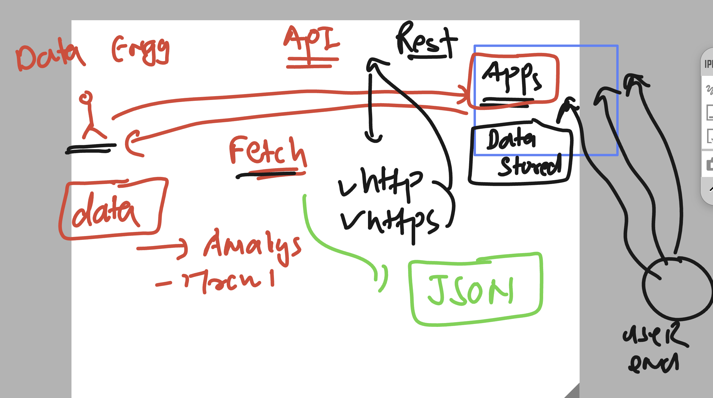

# python_azdevops_cas_20thoct2026

```
>>> import  time 
>>> dir(time)
['CLOCK_MONOTONIC', 'CLOCK_MONOTONIC_RAW', 'CLOCK_MONOTONIC_RAW_APPROX', 'CLOCK_PROCESS_CPUTIME_ID', 'CLOCK_REALTIME', 'CLOCK_THREAD_CPUTIME_ID', 'CLOCK_UPTIME_RAW', 'CLOCK_UPTIME_RAW_APPROX', '_STRUCT_TM_ITEMS', '__doc__', '__loader__', '__name__', '__package__', '__spec__', 'altzone', 'asctime', 'clock_getres', 'clock_gettime', 'clock_gettime_ns', 'clock_settime', 'clock_settime_ns', 'ctime', 'daylight', 'get_clock_info', 'gmtime', 'localtime', 'mktime', 'monotonic', 'monotonic_ns', 'perf_counter', 'perf_counter_ns', 'process_time', 'process_time_ns', 'sleep', 'strftime', 'strptime', 'struct_time', 'thread_time', 'thread_time_ns', 'time', 'time_ns', 'timezone', 'tzname', 'tzset']
>>> del time 
>>> 
>>> from time import  ctime 
>>> from time import  ctime,sleep
>>> 
>>> ctime()
'Wed Oct 21 22:29:17 2026'
>>> sleep(3)
>>> 
>>> import time as  t
>>> t.ctime()
'Wed Oct 21 22:29:48 2026'
>>> t.sleep(1)

```

## Understanding data fetching fundamentals 



