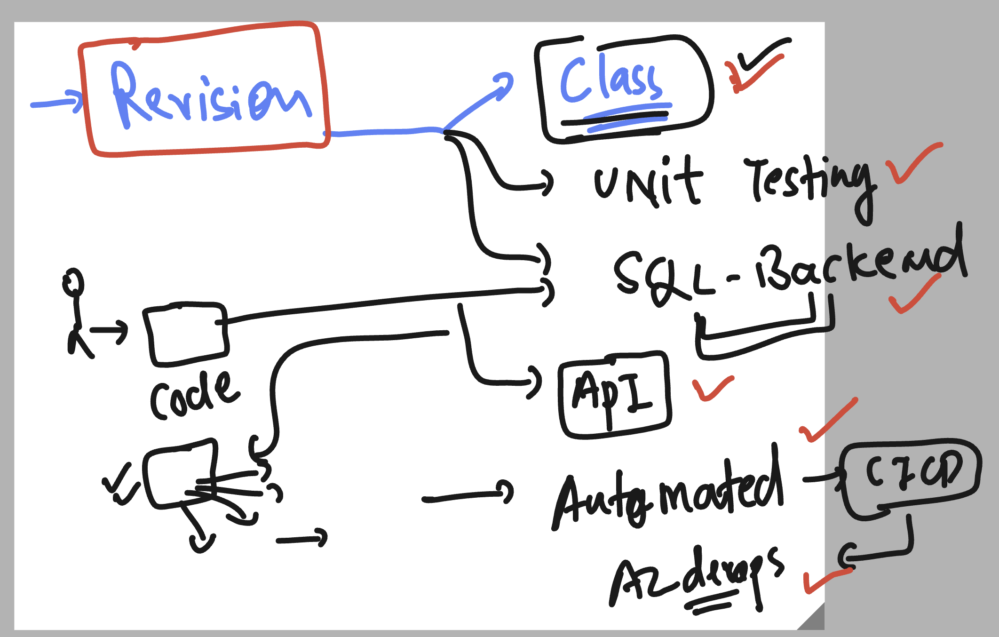
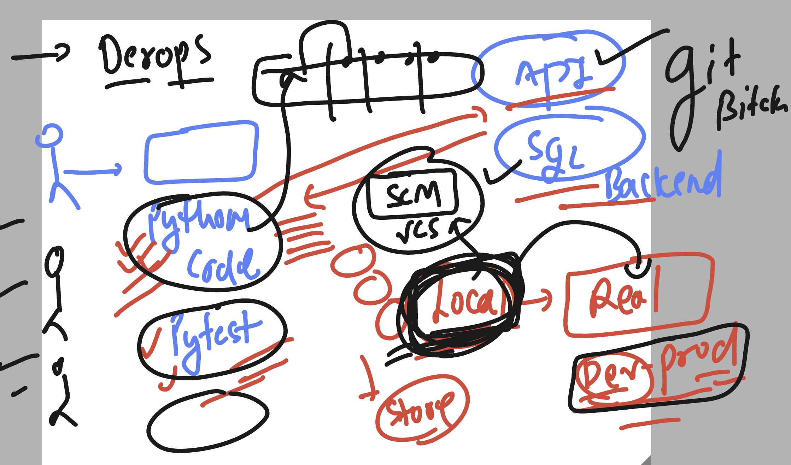
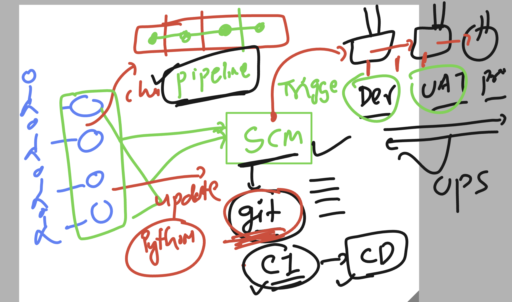
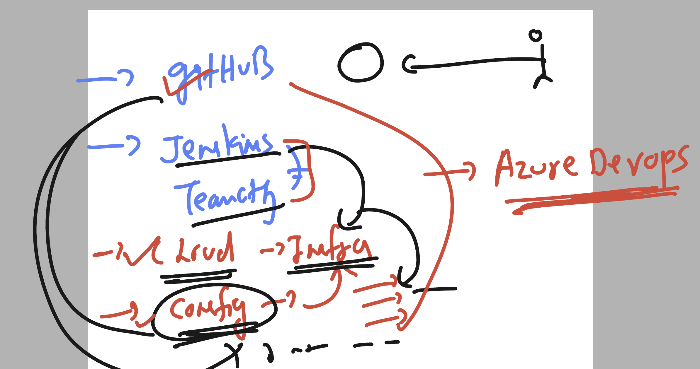
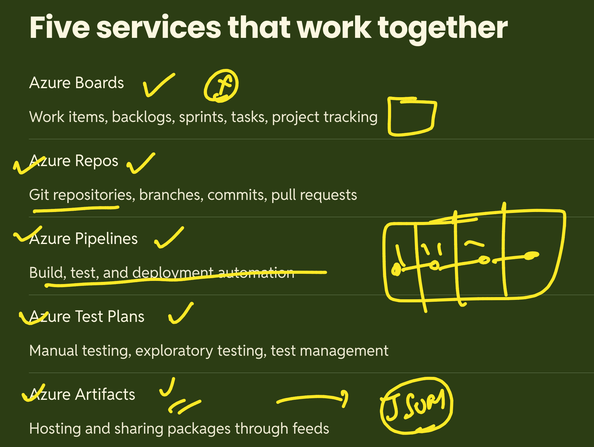
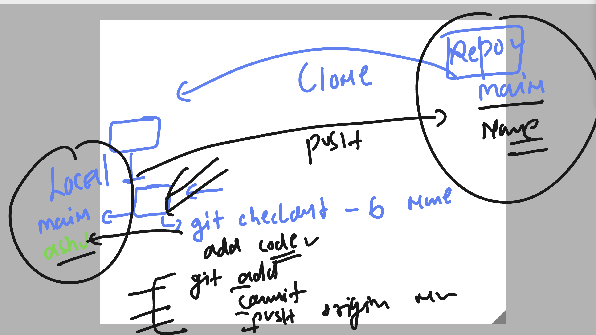

# python_azdevops_cas_20thoct2026

### Review 



### Installing pytest module 

```
root@docker-ubuntu:~/ashu-codes# source  casinoar-ashu/bin/activate
(casinoar-ashu) root@docker-ubuntu:~/ashu-codes# pip3 install pytest 
Collecting pytest
  Downloading pytest-9.1.1-py3-none-any.whl.metadata (7.6 kB)
Collecting iniconfig>=1.0.1 (from pytest)


===>

casinoar-ashu) root@docker-ubuntu:~/ashu-codes# pip3 list 
Package            Version
------------------ ----------
certifi            2026.10.19
charset-normalizer 3.5.2
idna               3.20
iniconfig          2.3.1
packaging          26.3
pip                24.0
pluggy             1.7.0
Pygments           2.21.0
pytest             9.1.1
requests           2.34.2
urllib3            2.8.0
(casinoar-ashu) root@docker-ubuntu:~/ashu-codes# pip3 install pytest 


```

### using pytest to of automated testing 

```
pytest  -v  day3/test_cal.py  
======================================== test session starts =========================================
platform linux -- Python 3.12.3, pytest-9.1.1, pluggy-1.7.0 -- /root/ashu-codes/casinoar-ashu/bin/python3
cachedir: .pytest_cache
rootdir: /root/ashu-codes
collected 1 item                                                                                     

day3/test_cal.py::test_add PASSED                                                              [100%]

========================================= 1 passed in 0.01s ==========================================
(casinoar-ashu) root@docker-ubuntu:~/ashu-codes# 

```

### code storage / management by SCM 



### cicd pipeline understanding 



### Understanding azure devops 




### azure devops components



### git clone 

```
git  clone  https://casinoaz-org@dev.azure.com/casinoaz-org/ashu-project/_git/new-cas-repo
Cloning into 'new-cas-repo'...
remote: Azure Repos
remote: We noticed you're using an older version of Git. For the best experience, upgrade to a newer version.
remote: Found 3 objects to send. (287 ms)
Unpacking objects: 100% (3/3), 738 bytes | 738.00 KiB/s, done.
root@docker-ubuntu:~/ashu-codes# ls
add_function.py   ashu1.txt        day2           new-cas-repo                  player-age-selector.py
api_activity.log  casinoar-ashu    day3           operation_ashu_records.json   player_check.py
ashu.txt          day1_summary.py  final_demo.py  operation_ashu_records3.json  var-test.py
root@docker-ubuntu:~/ashu-codes# cd  new-cas-repo/
root@docker-ubuntu:~/ashu-codes/new-cas-repo# ls
README.md
root@docker-ubuntu:~/ashu-codes/new-cas-repo# ls -a
.  ..  .git  README.md
root@docker-ubuntu:~/ashu-codes/new-cas-repo# 

```
### creating new branch using git cli 

```
root@docker-ubuntu:~/ashu-codes# ls
add_function.py   ashu1.txt        day2           new-cas-repo                  player-age-selector.py
api_activity.log  casinoar-ashu    day3           operation_ashu_records.json   player_check.py
ashu.txt          day1_summary.py  final_demo.py  operation_ashu_records3.json  var-test.py
root@docker-ubuntu:~/ashu-codes# cd  new-cas-repo/
root@docker-ubuntu:~/ashu-codes/new-cas-repo# 
root@docker-ubuntu:~/ashu-codes/new-cas-repo# git branch 
* main
root@docker-ubuntu:~/ashu-codes/new-cas-repo# 
root@docker-ubuntu:~/ashu-codes/new-cas-repo# git checkout -b  ashu
Switched to a new branch 'ashu'
root@docker-ubuntu:~/ashu-codes/new-cas-repo# git branch 
* ashu
  main
root@docker-ubuntu:~/ashu-codes/new-cas-repo# 

```

### adding code to repo & pushing changes to azure repo remotely 

```
git  add   ashu-code.py 
git commit -m "Making permanet chnages "
git push origin  ashu

```

### git workflow 




